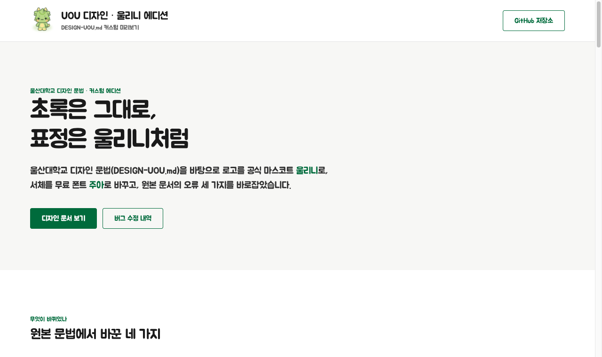

# UOU 디자인 · 울리니 에디션

울산대학교 디자인 문법(`DESIGN-UOU.md`)에 공식 마스코트 **울리니**와 무료 폰트 **주아(Jua)** 를 입힌 커스텀 에디션입니다. 원본 문서에 있던 오류 세 가지도 바로잡았습니다.

**▶ 미리보기 페이지: https://dandyjaewon-beep.github.io/uou-design-ulrinee/**

[](https://dandyjaewon-beep.github.io/uou-design-ulrinee/)

## 바꾼 것

| 항목 | 원본 | 울리니 에디션 |
|---|---|---|
| 로고 | 교표(기린 심볼) 중심 | 공식 마스코트 **울리니**를 페이지 로고로 사용 (학교 공개 원본 PNG, 수정 없음) |
| 폰트 | 윤고딕(YDYGO, 유료) | **주아(Jua)** — SIL OFL 1.1 무료 폰트, Google Fonts로 불러옴 |
| 굵기 | 400 / 600 / 700 | 400 하나 (주아는 굵기가 하나뿐이라 크기와 색으로 위계를 만듦) |
| 색상 | UOU Green 중심 | UOU Green 유지 + 울리니 공식 색상규정 7색을 보조 팔레트(`colors.ulrinee-*`)로 추가 |
| 컴포넌트 | — | `ulrinee-logo`, `ulrinee-callout`, `badge-ulrinee` 추가, 울리니 금지규정 5가지 명시 |

## 고친 버그

원본 `DESIGN-UOU.md`가 가리키던 경로와 이름이 실제 파일·정의와 달라서, 문서의 코드를 그대로 쓰면 폰트와 이미지가 불러와지지 않았습니다.

| # | 내용 | 이전 | 이후 |
|---|---|---|---|
| ① | 폰트 경로 (7곳) | `UOU_CI_폰트/윤고딕 폰트/YDYGO135.ttf` | `UOU_CI_font/YDYGO135.ttf` |
| ② | CI 이미지 경로 (2곳) | `UOU_CI/UOU_CI/uou_sm_*.gif` | `UOU_CI/uou_sm_01.gif` 등 |
| ③ | 토큰 이름 오타 (14곳, 11종) | `{component.button-primary}` | `{components.button-primary}` |

덧붙여 "Pretendard는 Google Fonts에 있다"는 설명을 바로잡았습니다(Pretendard는 GitHub·jsDelivr로 배포됨). 사이트 셸 전용인 내비게이션·푸터 반응형 항목에는 "콘텐츠 페이지는 해당 없음" 주석을 달았습니다.

## 사용법

`DESIGN-UOU.md`를 Claude 같은 AI 도구에 건네고 이렇게 요청하면 됩니다.

> 이 디자인 문법으로 ○○ 안내 페이지를 만들어 줘.

울리니 이미지는 `assets/ulrinee/`의 원본 그대로만 쓰고 기울이기, 선 굵기·색·형태 변경, 일부 자르기는 하지 않습니다(학교 금지규정).

## 파일 구성

```
DESIGN-UOU.md          디자인 문법 (울리니 에디션)
index.html             미리보기 페이지 (GitHub Pages)
assets/ulrinee/        울리니 공식 이미지 (기본형 2종)
assets/preview.png     README용 스크린샷
UOU_CI/                울산대 CI 이미지 (교표, UOU 심볼, 국·영문 로고)
```

## 출처와 라이선스

- 바탕 문서: 멘토링 자료로 공유받은 울산대학교 디자인 문법 `DESIGN-UOU.md`
- 울리니 캐릭터와 CI 이미지의 권리는 **울산대학교**에 있습니다. 학교 홈페이지(대학상징 › 마스코트 캐릭터, 울산대 UI)에 공개된 원본을 수정 없이 실었습니다.
- 주아(Jua): Woowahan Brothers, SIL Open Font License 1.1
- 윤고딕(YDYGO)은 유료 폰트라서 이 공개 저장소에 **포함하지 않았습니다.**
